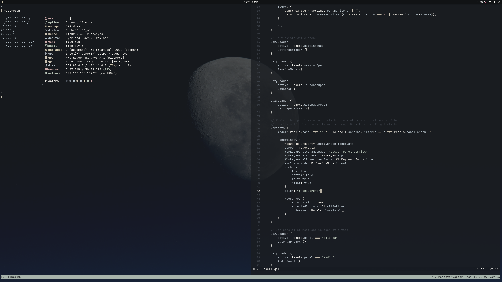

# dotfiles

My Linux desktop setup: [Hyprland](https://hypr.land) with a Lua config, [Ghostty](https://ghostty.org), tmux, [Helix](https://helix-editor.com) and [fuzzel](https://codeberg.org/dnkl/fuzzel), with [Vesper](https://github.com/TheyCallMePBJ/vesper), my own [Quickshell](https://quickshell.org) shell, for the bar, launcher and panels. The terminal, editor and fuzzel all use one colour theme (Compline). Managed with [GNU Stow](https://www.gnu.org/software/stow/).



## What's here

| Package | What it configures |
|---|---|
| `hypr` | Hyprland, split into modules: `binds`, `input`, `lookandfeel`, `windowrules`, `autostart`, plus per-host files and a `scripts/` folder |
| `ghostty` | Terminal: Compline theme, 80% background opacity (applied to cell backgrounds too) |
| `tmux` | `Ctrl+A` prefix, `Alt+h/j/k/l` to move between panes, mouse support |
| `helix` | Editor, Compline theme |
| `fuzzel` | Menu for the emoji picker, Compline theme |
| `fastfetch` | System info layout |

### One config, two machines

`hypr/host.lua` checks the hostname at startup and loads either `hosts/desktop.lua` or `hosts/laptop.lua`. The desktop file sets up two monitors: a 1440p 170 Hz main screen with workspaces 1–5, and a 1080p screen rotated to portrait with workspaces 6–10. It also starts a few desktop-only apps. The laptop file sets up the built-in screen only. Everything else is shared.


### Terminal

`Super+Enter` opens Ghostty inside tmux. Helix and tmux use the same theme as the rest of the desktop.


### Launcher and panels

At login Hyprland starts Vesper (`qs -c vesper`), which provides the bar, app launcher, control centre, notifications, wallpaper picker, session menu and settings panels. The keybinds talk to it over Quickshell IPC, including the volume, brightness and media keys.


## Keybinds

| Keys | Action |
|---|---|
| `Super+Enter` | Terminal (Ghostty + tmux) |
| `Super+Shift+Enter` | Terminal without tmux |
| `Super+E` | File manager (Nautilus) |
| `Super+Space` | App launcher |
| `Super+A` | Control centre |
| `Super+N` | Notifications |
| `Super+I` | Vesper settings |
| `Super+W` / `Super+Shift+W` | Wallpaper picker / random wallpaper |
| `Super+Escape` | Session menu |
| `Super+Shift+E` | Emoji picker |
| `Ctrl+Alt+X` | Clipboard history (clipdeck) |
| `Ctrl+Shift+Escape` | btop |
| `Super+Q` | Close window |
| `Super+h/j/k/l` or arrows | Move focus |
| `Super+Ctrl+h/j/k/l` | Swap windows |
| `Super+Shift+h/l` | Move window to the left/right monitor |
| `Super+1–0` / `Super+Shift+1–0` | Go to / move window to workspace |
| `Super+Tab` / `Super+Shift+Tab` | Next / previous workspace |
| `Super+-` / `Super+Shift+-` | Show scratchpad / move window to scratchpad |
| `Super+F` / `Super+Shift+F` | Maximise / fullscreen |
| `Super+V` | Toggle floating |
| `Super+T` | Toggle window opacity |
| `Super+Alt+Space` | Switch keyboard layout (QWERTY / Colemak-DH) |
| `Super+drag` / `Super+right-drag` | Move / resize window |
| `Super+Shift+S` | Screenshot a region (saved to `~/Pictures/Screenshots`) |
| `Super+Ctrl+S` | Screenshot a region to the clipboard |
| `Print` | Screenshot the current monitor |

## Install

Requires Hyprland with Lua config support, plus the programs you want to use: [Quickshell](https://quickshell.org) with [Vesper](https://github.com/TheyCallMePBJ/vesper) installed as the `vesper` config, Ghostty, tmux, Helix, fuzzel, fastfetch, hyprshot, cliphist, wl-clipboard and clipdeck (expected at `~/.cargo/bin/clipdeck`).

```sh
git clone https://github.com/TheyCallMePBJ/dotfiles.git ~/dotfiles
cd ~/dotfiles
stow hypr ghostty tmux helix fuzzel fastfetch   # or only the ones you want
```

Each folder is a Stow package that mirrors your home directory, so `stow ghostty` symlinks `~/.config/ghostty` to this repo. Back up or remove an existing config before stowing over it.

To use the Hyprland config on your own machines, edit the hostname check in `hypr/.config/hypr/host.lua` and the monitor names in `hosts/`. Run `hyprctl monitors` to list your monitors.

## Related

- [Vesper](https://github.com/TheyCallMePBJ/vesper): the Quickshell bar and panels this setup uses.
