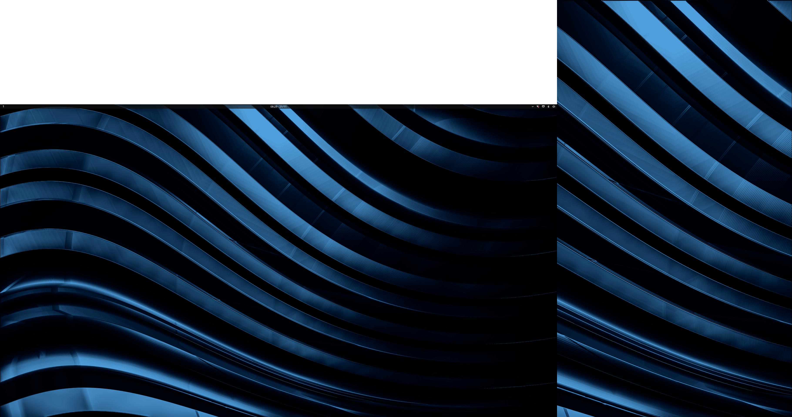
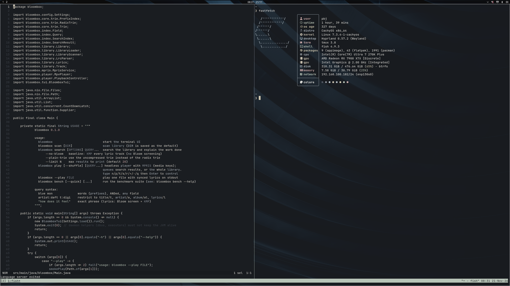
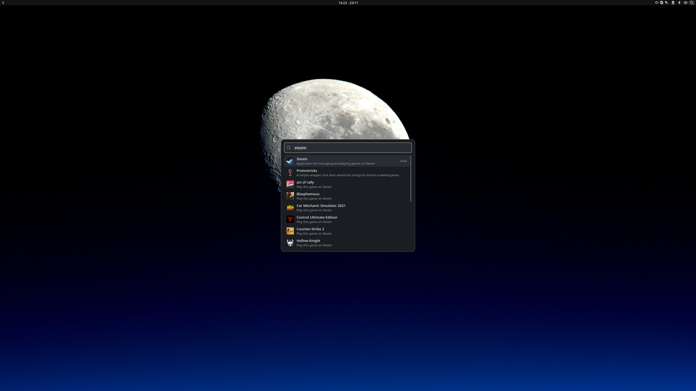

# dotfiles

My Linux desktop setup: [Hyprland](https://hypr.land) with a Lua config, [Ghostty](https://ghostty.org), tmux, [Helix](https://helix-editor.com) and [fuzzel](https://codeberg.org/dnkl/fuzzel), with [noctalia-shell](https://github.com/noctalia-dev/noctalia-shell) for the bar, launcher and panels. The terminal, editor and fuzzel all use one colour theme (Compline). Managed with [GNU Stow](https://www.gnu.org/software/stow/).


<!-- SCREENSHOT: docs/desktop.png, the main desktop (see notes) -->

## What's here

| Package | What it configures |
|---|---|
| `hypr` | Hyprland, split into modules: `binds`, `input`, `lookandfeel`, `windowrules`, `autostart` |
| `ghostty` | Terminal: Compline theme, slight transparency |
| `tmux` | `Ctrl+A` prefix, `Alt+h/j/k/l` to move between panes, mouse support |
| `helix` | Editor, Compline theme |
| `fuzzel` | Menu for the emoji picker, Compline theme |
| `fastfetch` | System info layout |

### One config, two machines

`hypr/host.lua` checks the hostname at startup and loads either `hosts/desktop.lua` or `hosts/laptop.lua`. The desktop file sets up two monitors: a 1440p 170 Hz main screen with workspaces 1–5, and a 1080p screen rotated to portrait with workspaces 6–10. It also starts a few desktop-only apps. The laptop file sets up the built-in screen only. Everything else is shared.


<!-- SCREENSHOT: docs/dual-monitor.png, both desktop monitors (see notes) -->

### Terminal

`Super+Enter` opens Ghostty inside tmux. Helix and tmux use the same theme as the rest of the desktop.


<!-- SCREENSHOT: docs/terminal.png, terminal close-up (see notes) -->

### Launcher and panels


<!-- SCREENSHOT: docs/launcher.png, launcher open (see notes) -->

## Keybinds

| Keys | Action |
|---|---|
| `Super+Enter` | Terminal (Ghostty + tmux) |
| `Super+Shift+Enter` | Terminal without tmux |
| `Super+Space` | App launcher |
| `Super+A` | Control centre |
| `Super+Escape` | Session menu |
| `Super+Shift+E` | Emoji menu |
| `Super+Q` | Close window |
| `Super+h/j/k/l` or arrows | Move focus |
| `Super+Ctrl+h/j/k/l` | Swap windows |
| `Super+Shift+h/l` | Move window to the left/right monitor |
| `Super+1–0` / `Super+Shift+1–0` | Go to / move window to workspace |
| `Super+Tab` | Next workspace |
| `Super+-` | Scratchpad (special workspace) |
| `Super+F` / `Super+Shift+F` | Maximise / fullscreen |
| `Super+V` | Toggle floating |
| `Super+Shift+S` | Screenshot a region |
| `Print` | Screenshot the current monitor |

## Install

Requires Hyprland with Lua config support, plus the programs you want to use (noctalia-shell, Ghostty, tmux, Helix, fuzzel, fastfetch, hyprshot, cliphist).

```sh
git clone https://github.com/TheyCallMePBJ/dotfiles.git ~/dotfiles
cd ~/dotfiles
stow hypr ghostty tmux helix fuzzel fastfetch   # or only the ones you want
```

Each folder is a Stow package that mirrors your home directory, so `stow ghostty` symlinks `~/.config/ghostty` to this repo. Back up or remove an existing config before stowing over it.

To use the Hyprland config on your own machines, edit the hostname check in `hypr/.config/hypr/host.lua` and the monitor names in `hosts/`. Run `hyprctl monitors` to list your monitors.

## Related

- [Vesper](https://github.com/TheyCallMePBJ/vesper): the Hyprland bar I wrote with Quickshell.
